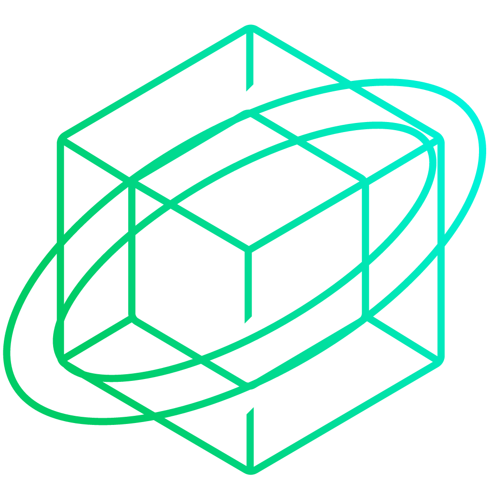
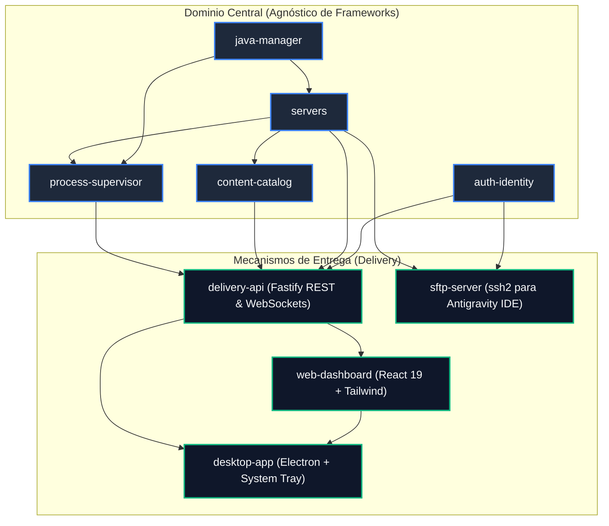

<div align="center">



# 🌌 Singularity
### *The Next-Generation Minecraft Server Orchestrator & Mission Control*
**Un producto oficial de NebulaX Studio**

[](https://github.com/xavieraimacana/Singularity/releases/tag/v0.1.0-alpha)
[](https://github.com/xavieraimacana/Singularity/releases/tag/v0.1.0-alpha)
[](https://github.com/xavieraimacana/Singularity)
[](https://www.typescriptlang.org/)
[](https://nodejs.org/)
[](https://fastify.dev/)
[](https://react.dev/)
[](https://www.electronjs.org/)
[](https://www.sqlite.org/)
[](LICENSE)

<br/>

**Singularity** unifica en una sola plataforma la potencia operativa 24/7 y monitoreo en tiempo real de **Crafty Controller**, la facilidad de instalación de modpacks y plugins de **Prism Launcher**, la agilidad de una **Aplicación de Escritorio con System Tray** y la comodidad de editar archivos directamente desde **Antigravity IDE / VS Code** mediante un micro-servidor SFTP embebido.

[Características](#-características-principales) • [Arquitectura](#-arquitectura-screaming-architecture) • [Stack Tecnológico](#-stack-tecnológico) • [Inicio Rápido](#-inicio-rápido) • [Integración con Antigravity IDE](#-integración-con-antigravity-ide--vs-code) • [Despliegue en la Nube (OCI)](#-despliegue-en-vps-y-oracle-cloud-oci) • [Documentación](#-documentación-técnica)

---

</div>

## 🌟 ¿Por qué Singularity?

Administrar servidores de Minecraft ha estado fragmentado durante años:
- **Paneles Web Tradicionales**: Requieren buscar manualmente archivos `.jar`, descargar plugins o mods en navegadores externos, subirlos penosamente por gestores web o FTPs lentos, y descifrar a ciegas crash reports crípticos.
- **Launchers de Cliente (como Prism Launcher)**: Tienen el mejor catálogo del mundo (Modrinth, CurseForge) y resolución automática de dependencias, pero solo funcionan en el cliente de juego local, no en servidores dedicados 24/7.

**Singularity condensa todo ese ecosistema en una única solución de alta ingeniería:**
1. **Despliegue en 3 Clics**: Crea instancias de Vanilla, Paper, Purpur, Fabric, Forge o NeoForge con detección automática del runtime Java requerido.
2. **Catálogo Prism Integrado**: Busca e instala Modpacks (`.mrpack`), Mods, Plugins y Datapacks de **Modrinth**, **CurseForge** y **PaperMC** en 1 clic.
3. **Diagnóstico Inteligente de Crashes**: Analiza automáticamente logs de errores identificando al instante la causa (Java incorrecto, mods incompatibles, mods client-side en servidor) y ofrece solución en 1 clic.
4. **Desktop Nativo & System Tray**: Minimiza la app al área de notificación de Windows/Linux sin depender de pestañas de navegador.
5. **Edición Remota en Vivo desde Antigravity IDE**: Micro-servidor SFTP interno que te permite abrir el servidor como un proyecto en tu editor y guardar cambios en vivo.

---

## ⚡ Características Principales

| Módulo | Descripción |
|---|---|
| 🚀 **Orquestador Multi-Instancia** | Control total e independiente de múltiples servidores simultáneos (Vanilla, Paper, Purpur, Fabric, Forge, NeoForge). |
| 📦 **Catálogo de Contenido Prism** | Integración nativa con **Modrinth v2**, **PaperMC** y **CurseForge** con resolución automática de dependencias y actualización en 1 clic. |
| 🩺 **Motor de Diagnóstico de Crashes** | Reconocimiento heurístico en logs de `UnsupportedClassVersionError`, `OutOfMemory`, mods de cliente en servidor y mundos corruptos. |
| 💻 **Antigravity IDE / VS Code Bridge** | Botón local "Abrir en Antigravity IDE" y **Micro-servidor SFTP embebido** (puerto `2022`) para edición remota de configs con guardado en vivo. |
| 🖥️ **Aplicación de Escritorio Nativa** | Shell Electron con bandeja del sistema (System Tray), alertas nativas del SO para caídas de servidor y selector multi-nodo (Local/VPS). |
| 💾 **Backups & Restauración Segura** | Creación de copias `.tar.gz` en 1 clic, historial con comentarios, guard anti-corrupción y streaming de descarga. |
| 📂 **Explorador de Archivos Web** | Navegación segura en jaula anti path-traversal, editor de texto integrado con `Ctrl+S`, creación, borrado y descargas. |
| ⏱️ **Programador de Tareas (Cron)** | Automatización de auto-backups, reinicios con aviso previo en chat a jugadores y comandos programados (`save-all`). |
| ☕ **Java Runtime Manager** | Auto-detección de runtimes Java (8, 11, 17, 21, 25), validación de compatibilidad con versiones de Minecraft y banderas optimizadas (*Aikar's Flags*). |
| 🎨 **Editor Visual & MOTD en Vivo** | Configuración visual de `server.properties` con switches, sliders y previsualizador en vivo de la tarjeta multijugador con soporte de colores `§` y MiniMessage. |
| 👥 **Gestor de Jugadores con Skins** | Visualización en tiempo real de jugadores conectados con avatares 2D/3D (Minotar API) y comandos rápidos (OP, Kick, Ban, Whitelist). |
| 🖥️ **Terminal VT100 en Tiempo Real** | Emulador ANSI completo vía `@xterm/xterm` y WebSockets bidireccionales con buffer circular y filtros inteligentes. |
| ⚡ **Command Palette (`Ctrl+K`)** | Búsqueda global instantánea para alternar entre servidores, buscar mods y lanzar comandos con atajos de teclado. |
| 🛡️ **Supervisión Concurrente Blindada** | Terminación en árbol (`tree-kill` en Windows / Process Groups en Linux) y timeout de 15s tras `/stop` para evitar procesos huérfanos. |

---

## 🏛️ Arquitectura (Screaming Architecture)

Siguiendo las directrices de arquitectura de **NebulaX Studio**, la capa de entrega (Web, Desktop, SFTP) es un simple adaptador. La lógica de negocio del dominio de Minecraft es **100% pura y agnóstica de frameworks**:

```
src/
├── auth-identity/       # Dominio: Cuentas, roles (Admin, Operator, Viewer), JWT y sesiones
├── java-manager/        # Dominio: Detección de runtimes Java, compatibilidad y Aikar's Flags
├── servers/             # Dominio: Instancias de servidor, ciclo de vida, properties y motd
├── content-catalog/     # Dominio: Proveedores (Modrinth, PaperMC, CurseForge) e instalador
├── process-supervisor/  # Dominio: Supervisión de procesos Java, I/O terminal y diagnósticos
├── backups/             # Dominio: Copias de seguridad comprimidas .tar.gz y restauración segura
├── file-manager/        # Dominio: Explorador de archivos aislado en jaula anti path-traversal
├── task-scheduler/      # Dominio: Programador de tareas periódicas, reinicios y expresiones Cron
└── delivery/            # Mecanismo de Entrega (Delivery Mechanism)
    ├── http/            # API RESTful de alto rendimiento con Fastify
    ├── websocket/       # Streaming en tiempo real de consola y métricas
    ├── sftp/            # Micro-servidor SFTP embebido para Antigravity IDE
    ├── web-dashboard/   # SPA moderna en React 19 + Tailwind CSS + Lucide
    └── desktop/         # Shell de escritorio nativo Electron + System Tray
```



---

## 📦 Stack Tecnológico

| Capa | Componente | Tecnología | Versión | Justificación |
|---|---|---|---|---|
| **Runtime** | Motor de Ejecución | Node.js | `v24.15+ LTS` | Soporte nativo para ESM, TypeScript y bajo consumo de recursos. |
| **Backend** | Framework HTTP / WS | Fastify | `v5.x` | Rendimiento líder en I/O asíncrono y streaming no bloqueante. |
| **Persistencia** | Base de Datos | SQLite | `better-sqlite3` | Síncrono, embebido, ultrarrápido y libre de administración externa. |
| **Seguridad** | Cifrado y Sesiones | Argon2 / JWT | `@fastify/jwt` | Autenticación robusta basada en roles (*Admin*, *Operator*, *Viewer*). |
| **Remoto** | Servidor SFTP | ssh2 | `v1.x` | Protocolo estándar de la industria para edición remota en IDEs. |
| **Frontend** | Interfaz Web | React 19 + Vite | `v19.x` | Renderizado ultra reactivo y bundling optimizado. |
| **Desktop** | Shell de Escritorio | Electron | `v34+` | Acceso nativo a System Tray, notificaciones del SO y atajos de sistema. |
| **Terminal** | Emulador Web ANSI | xterm.js | `v5.x` | Emulación VT100 fiel para consola de servidor y filtros de logs. |
| **Testing** | Suite de Pruebas | Vitest | `v2.x` | Tests unitarios de dominio rápidos y aislamiento de I/O. |

---

## 🚀 Inicio Rápido

### Requisitos Previos
* **Node.js**: `v20.0+` (Recomendado `v24.15+ LTS`)
* **Java**: Java 17, 21 o 25 instalado en el sistema
* **Git**: Para control de versiones

### 1. Clonar e Instalar Dependencias
```bash
# Clonar el repositorio
git clone https://github.com/nebulax-studio/singularity.git
cd singularity

# Instalar dependencias del proyecto
npm install

# Configurar variables de entorno
cp .env.example .env
```

### 2. Ejecutar en Modo Desarrollo

```bash
# Iniciar Servidor Fastify + Dashboard Web con Hot Reload
npm run dev

# (Opcional) Iniciar la Aplicación de Escritorio Electron
npm run dev:desktop
```

El panel estará disponible de inmediato en:
🌐 **`http://localhost:3000`**

### 🔑 Credenciales Iniciales de Administrador
Al arrancar por primera vez, Singularity inicializa una cuenta de administrador por defecto:
* **Usuario:** `admin`
* **Contraseña:** `admin`

---

## 🪟 Instalación en Windows (Desktop App)

Singularity incluye ejecutables de escritorio nativos para Windows 10 y 11 x64 generados con `electron-builder`:

### Descargas Oficiales
* 💿 **[Instalador Completo NSIS (Setup)](https://github.com/xavieraimacana/Singularity/releases/download/v0.1.0-alpha/Singularity-Setup-0.1.0-alpha.exe)**: `Singularity-Setup-0.1.0-alpha.exe` *(~90 MB)*
  * Asistente paso a paso para seleccionar ruta de instalación.
  * Accesos directos en el Escritorio y Menú Inicio.
  * Desinstalador limpio registrado en el Panel de Control de Windows.
* 🚀 **[Ejecutable Portable](https://github.com/xavieraimacana/Singularity/releases/download/v0.1.0-alpha/Singularity-Portable-0.1.0-alpha.exe)**: `Singularity-Portable-0.1.0-alpha.exe` *(~82 MB)*
  * Ejecución directa sin instalación ni privilegios de administrador.
  * Ideal para llevar en pendrive o ejecutar en entornos aislados.

> 📦 Consulta todas las notas de lanzamiento y archivos checksum en [GitHub Releases](https://github.com/xavieraimacana/Singularity/releases).

### Capacidades Nativas de Windows
* 🔔 **Notificaciones en el Centro de Actividades de Windows**: Alertas del sistema cuando un servidor se inicia, se detiene o sufre un crash inesperado (`appUserModelId: studio.nebulax.singularity`).
* 📥 **Minimizado a la Bandeja del Sistema (System Tray)**: Cierra la ventana sin interrumpir los servidores. Control rápido desde el menú contextual del icono en la barra de tareas.
* ⚡ **Arranque Automático en el Inicio de Windows**: Configurable directamente desde los ajustes de la bandeja del sistema (con opción de arranque en segundo plano oculto).
* 🛠️ **Compilación Manual**:
  ```bash
  npm run dist          # Compila backend, web y empaqueta instalador + portable
  npm run dist:portable # Compila únicamente el ejecutable portable
  ```

> [!IMPORTANT]
> **Rotación Obligatoria de Credenciales:** Por motivos de seguridad, en el primer inicio de sesión el sistema solicitará obligatoriamente actualizar la contraseña de administrador.

---

## 💻 Integración con Antigravity IDE / VS Code

Singularity te permite modificar configs de mods (`.toml`, `.json`), `server.properties`, datapacks y scripts de KubeJS directamente desde tu editor favorito sin tocar el panel web:

### A. Para Servidores Locales
En la vista de detalle de cualquier servidor dentro de Singularity, pulsa el botón **"Abrir en Antigravity IDE"**. La carpeta de la instancia (`data/servers/<id>/`) se abrirá de inmediato en tu editor.

### B. Para Servidores Remotos (VPS / Oracle Cloud)
1. Instala en **Antigravity IDE** o **VS Code** cualquier extensión SFTP estándar (ej. *SFTP* por Natizyskunk o *Remote - SSH*).
2. Añade en tu proyecto local el archivo `.vscode/sftp.json`:
```json
{
  "name": "Singularity VPS",
  "host": "IP_DE_TU_VPS",
  "protocol": "sftp",
  "port": 2022,
  "username": "admin",
  "password": "TU_PASSWORD",
  "remotePath": "/servers/srv_01",
  "uploadOnSave": true
}
```
3. ¡Listo! Cada vez que guardes con `Ctrl + S`, el archivo se actualizará al instante en tu servidor en la nube.

---

## ☁️ Despliegue en VPS y Oracle Cloud (OCI)

Singularity está diseñado para operar de forma desatendida 24/7 en servidores Linux en la nube (Ubuntu / Debian / Oracle Linux):

### 1. Puertos de Red Requeridos
| Puerto | Protocolo | Servicio |
|:---:|:---:|---|
| **`3000`** | TCP | Panel Web, API REST y WebSocket de Consola |
| **`2022`** | TCP | Micro-Servidor SFTP para Antigravity IDE / VS Code |
| **`25565`** | TCP / UDP | Puerto por defecto para servidores de Minecraft |

### 2. Configuración en Oracle Cloud Infrastructure (OCI)
En la consola web de Oracle Cloud:
1. Navega a **Networking** > **Virtual Cloud Networks (VCN)** > Tu VCN > **Security Lists**.
2. Añade las siguientes **Ingress Rules** (Reglas de Ingreso):
   * **CIDR:** `0.0.0.0/0` | **Protocolo:** TCP | **Destination Port Range:** `3000, 2022, 25565`
   * **CIDR:** `0.0.0.0/0` | **Protocolo:** UDP | **Destination Port Range:** `25565` (consultas UDP y Bedrock/Geyser)

### 3. Reglas de Firewall en Linux
```bash
# En sistemas con UFW (Ubuntu/Debian):
sudo ufw allow 3000/tcp
sudo ufw allow 2022/tcp
sudo ufw allow 25565/tcp
sudo ufw allow 25565/udp
sudo ufw reload

# En sistemas con iptables nativo (Oracle Linux / Ubuntu OCI):
sudo iptables -I INPUT 6 -m state --state NEW -p tcp --dport 3000 -j ACCEPT
sudo iptables -I INPUT 6 -m state --state NEW -p tcp --dport 2022 -j ACCEPT
sudo iptables -I INPUT 6 -m state --state NEW -p tcp --dport 25565 -j ACCEPT
sudo iptables -I INPUT 6 -m state --state NEW -p udp --dport 25565 -j ACCEPT
sudo netfilter-persistent save
```

### 4. Despliegue con Docker, Coolify y CasaOS
Singularity incluye soporte nativo y optimizado para **Docker Compose**, **Coolify** y **CasaOS**:

```bash
# Despliegue automatizado en Oracle Cloud (configura firewall, secretos y levanta contenedores):
sudo bash scripts/deploy-oracle.sh

# O manualmente con Docker Compose:
docker compose up -d --build
```

#### Despliegue en Coolify:
1. Agrega una nueva aplicación en tu dashboard de Coolify seleccionando tu repositorio Git: `https://github.com/xavieraimacana/Singularity.git`.
2. Selecciona el tipo de construcción **Docker Compose** o **Dockerfile**.
3. Coolify detectará los puertos `3000` (Dashboard Web), `2022` (SFTP) y `25565-25585` (Minecraft).

#### Despliegue en CasaOS:
1. En el panel de CasaOS, ve a **App Store** > **Custom Install**.
2. Haz clic en **Import** en la esquina superior derecha y pega el contenido de `docker-compose.yml`.
3. Haz clic en **Submit** e instala la aplicación.

---

## 🧪 Pruebas y Control de Calidad

Singularity aplica **Test-Driven Development (TDD)** con aislamiento riguroso de I/O y mocks de red. Actualmente cuenta con **134 pruebas unitarias y de integración pasando al 100%** a través de 28 suites en Vitest:

```bash
# Ejecutar todas las pruebas unitarias
npm test

# Ejecutar pruebas con reporte de cobertura
npm run test:coverage

# Análisis estático de tipos y linter
npm run lint

# Compilación de producción completa (Backend + Web + Desktop)
npm run build
```

---

## 📑 Documentación Técnica

* 🗺️ [Mapa de Capacidades del Sistema](docs/CAPABILITY_MAP.md)
* 📐 [Especificación Técnica Completa](docs/superpowers/specs/2026-10-30-pismcontroller-design.md)
* 📋 [Plan de Implementación Detallado (16 Tareas)](docs/superpowers/plans/2026-10-30-pismcontroller-implementation.md)
* 📝 [Registro de Decisiones Arquitectónicas (ADRs)](docs/decisions/)
  * [ADR-001: Screaming Architecture y Monolito Modular](docs/decisions/0001-screaming-architecture-modular-monolith.md)
  * [ADR-002: Abstracción de Proveedores para el Catálogo](docs/decisions/0002-content-catalog-provider-abstraction.md)
* 🛡️ [Auditoría de Seguridad y Hardening](docs/SECURITY_AUDIT.md)

---

## 🤝 Estándares de Contribución

Como producto de **NebulaX Studio**, seguimos estándares de ingeniería estrictos:
* **Commits:** Aplicamos [Conventional Commits](https://www.conventionalcommits.org/) en español (`feat: ...`, `fix: ...`, `test: ...`, `docs: ...`).
* **Clean Code:** Principios SOLID, tipado estricto en TypeScript sin `any`, y respeto absoluto a la independencia del dominio frente a los frameworks.

---

## 📄 Licencia

Este proyecto está bajo la Licencia **MIT** — consulta el archivo `LICENSE` para más detalles.

<div align="center">
  <sub>Desarrollado con precisión por <strong>NebulaX Studio</strong> para la comunidad global de Minecraft.</sub>
</div>
