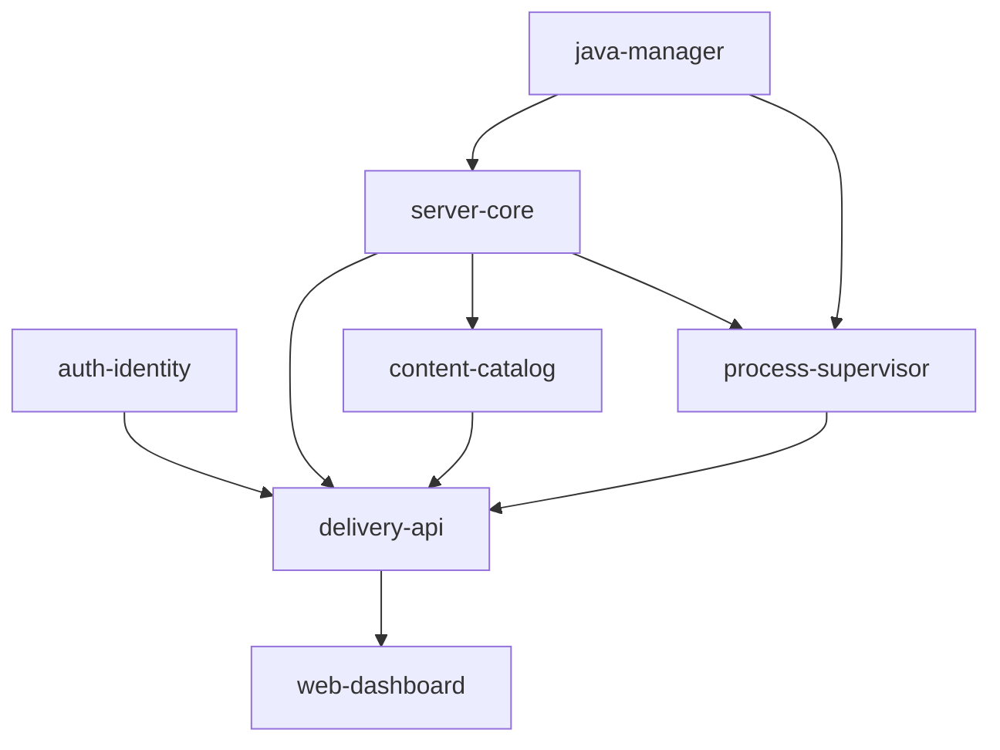

# Capability Map: PismController

**PismController** es una plataforma moderna para la orquestación y administración de servidores de Minecraft, combinando el control de instancias 24/7 y métricas web de **Crafty Controller** con la facilidad de instalación de modpacks, plugins, mods y datapacks de **Prism Launcher**.

---

## Módulos y Responsabilidades

| Module ID | Responsabilidad | Dependencias |
|---|---|---|
| `auth-identity` | Cuentas locales, roles (*Admin*, *Operator*, *Viewer*), tokens JWT / sesiones seguras, hashing de contraseñas. | — |
| `java-manager` | Detección automática de runtimes Java en el SO (Java 8, 11, 17, 21, 25), validación de compatibilidad con versiones de Minecraft, optimización de flags JVM (Aikar's Flags). | — |
| `server-core` | Dominio de instancias: creación de servidores, persistencia, editor visual de `server.properties`, diseñador de MOTD y Favicon, gestión de puertos y snapshots/backups en .zip. | `java-manager` |
| `content-catalog` | Abstracción de repositorios (Modrinth API v2, CurseForge, PaperMC/Purpur, Fabric/Forge). Búsqueda, descarga, 1-click update de mods/plugins y resolución de dependencias. | `server-core` |
| `process-supervisor` | Control de procesos Java, streaming interactivo de consola stdin/stdout en tiempo real (xterm.js), autorestart, métricas (CPU/RAM/TPS), lista de jugadores conectados con skins (Minotar API) y **motor de diagnóstico automático de crashes**. | `server-core`, `java-manager` |
| `delivery-api` | Servidor HTTP y WebSocket (Fastify) que expone endpoints RESTful y canales de WebSocket para el panel web y herramientas de CLI. Optimizado para ejecución en local y en VPS Cloud (ej. Oracle Cloud Infrastructure). | `auth-identity`, `server-core`, `content-catalog`, `process-supervisor` |
| `web-dashboard` | Interfaz de usuario SPA moderna (React + Tailwind CSS + Lucide + Terminal xterm.js). Asistente de creación de servidor, catálogo interactivo con 1-click install/update, consola con filtros, Command Palette (`Ctrl+K`), diseñador de MOTD y panel de jugadores con skins. | `delivery-api` |

---

## Orden de Construcción (Build Order)

1. **Fase 1: Fundaciones de Dominio**
   - `auth-identity` & `java-manager`
   - `server-core`
2. **Fase 2: Ejecución y Contenido**
   - `process-supervisor` (Procesos, consolas, WebSockets)
   - `content-catalog` (Integración Modrinth, PaperMC, CurseForge)
3. **Fase 3: Mecanismo de Entrega**
   - `delivery-api` (Gateway Fastify + WebSockets)
   - `web-dashboard` (UI React / Tailwind / xterm.js)
